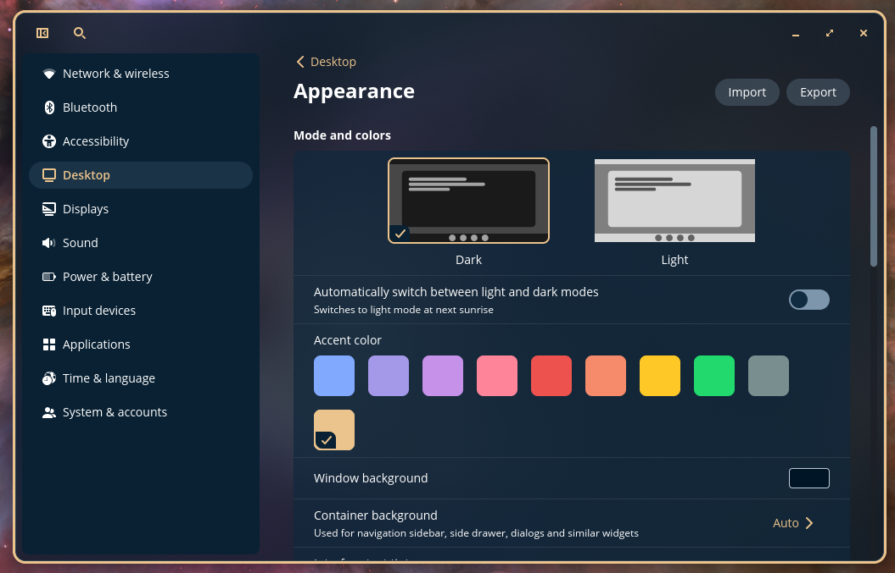
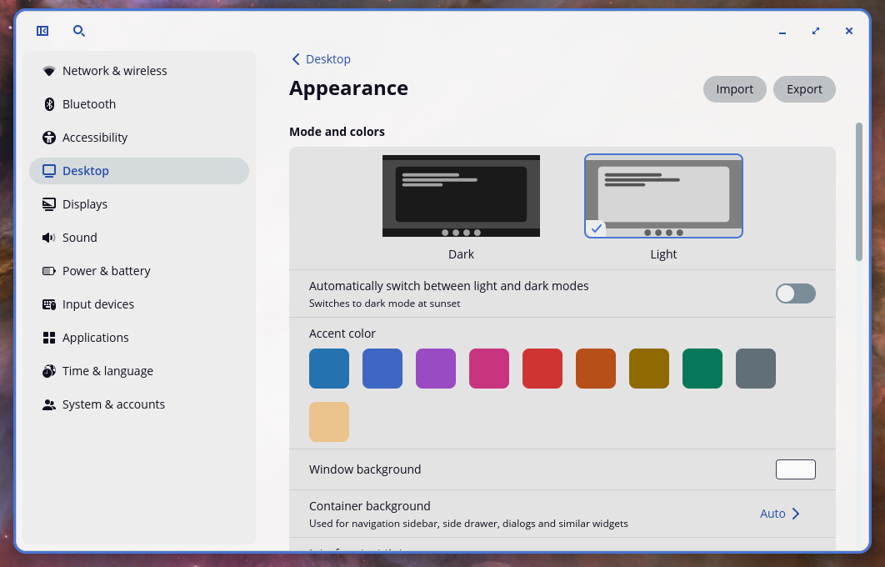

# Night-Owl-PopOS-Theme
Night Owl and Light Owl themes for PopOS

Based on Sarah Drasner's [Night Owl and Light Owl VSCode Themes](https://github.com/sdras/night-owl-vscode-theme).

## Preview

#### Night Owl:


#### Light Owl:


## Install
#### Download from source:
1. Download or Clone this repo

   ```shell
   git@github.com:astoltzfus/Night-Owl-PopOS-Theme.git
   ```

2. Open "COSMIC Settings" -> "Desktop" -> "Appearance" and click "Import"
3. Select the "Night_Owl.ron" or "Light_Owl.ron" file and Open
